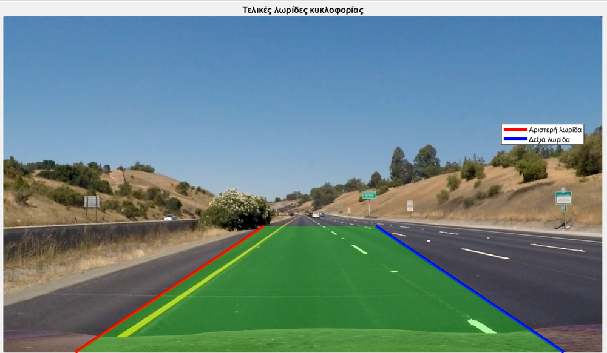
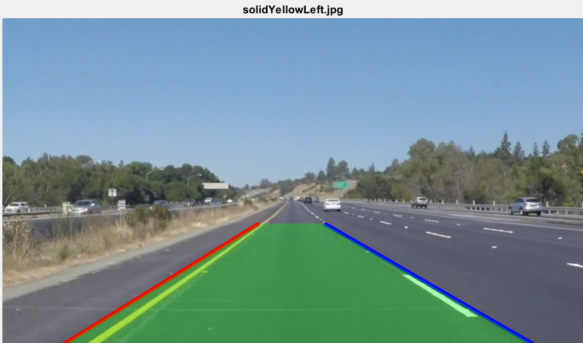
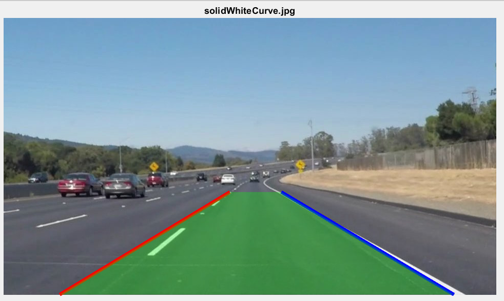
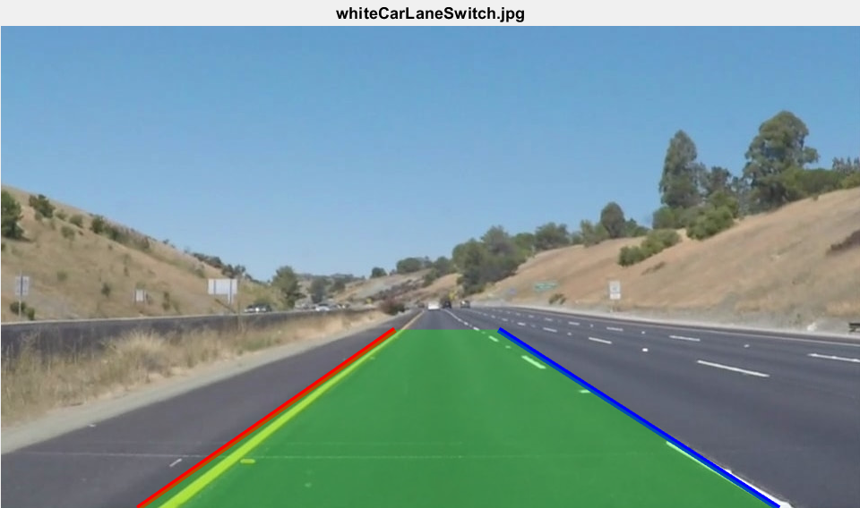
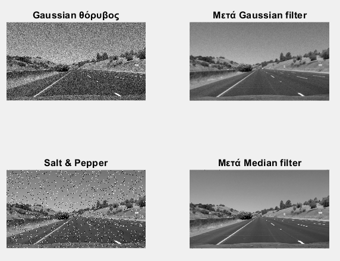

# Image Processing & Lane Detection

Coursework for *Digital Image Processing & Analysis* (University of Patras, CEID, 2025–26) in two parts:
- **Part A:** six notebooks that implement core image processing techniques **from first principles with NumPy/SciPy**, with quantitative evaluation where possible
- **Part B:** a complete **road lane-detection pipeline** (MATLAB), tested on 8 real driving scenes


## Part B: Lane detection with Canny + Hough transform

<p>
  
  
</p>

**Pipeline** ([`07-lane-detection`](07-lane-detection)):

1. **Preprocessing:** grayscale conversion and Gaussian smoothing (σ = 2), compared against a 5×5 mean filter
2. **Region of interest:** trapezoidal mask that follows the road's perspective, removing sky, trees and signs
3. **Edge detection:** Sobel vs Canny; Canny thresholds tuned to [0.10, 0.20]
4. **Hough transform:** line detection (`FillGap = 40`, `MinLength = 30`), then rejection of near-horizontal lines (|slope| ≤ 0.3)
5. **Lane estimation:** segments grouped into left/right lane by slope and position, one **linear regression** per side, drivable area shaded
6. **Robustness to noise:** Gaussian and salt-and-pepper noise added; Gaussian and median filtering compared before re-running detection
7. **Generalisation:** reusable `detect_lanes.m` with a resolution-independent ROI, evaluated on 8 scenes

| Scene | Result |
|---|---|
| Straight road, clear markings | Both lanes detected accurately |
| Yellow + white markings | Both detected; grayscale keeps enough contrast for both colours |
| Other vehicles / lane change | Robust; road edges dominate the Hough accumulator |
| Multiple lanes | Boundary lanes found, slight shift from vehicle edges |
| Faded markings, shadows, urban clutter | Partial: weak edges get few Hough votes, shadows create false edges |
| Curved road | Only the straight part is followed (a fundamental limit of straight-line Hough) |

**Next step I'd take:** fit second-order polynomials on a bird's-eye (perspective-warped) view to follow curves, or train a small segmentation CNN.

<p>
  
  
  
</p>

Test images: Udacity Self-Driving Car Nanodegree sample images and the [KITTI Road](https://www.cvlibs.net/datasets/kitti/eval_road.php) dataset (CC BY-NC-SA 3.0), provided by the course.

## Part A: Image processing from first principles

| # | Topic | What is implemented | Key finding |
|---|---|---|---|
| 1 | [Frequency-domain filtering](01-frequency-domain-filtering) | 2-D FFT, centred spectrum, ideal low-pass filter (D0 = 30) | Sharp cut-off causes ringing; Butterworth/Gaussian filters avoid it |
| 2 | [Histogram equalization](02-histogram-equalization) | Global vs adaptive (local) equalization on night-time road images | Adaptive equalization reveals hidden detail with far less noise amplification |
| 3 | [Image denoising](03-image-denoising) | Gaussian & impulse noise, moving-average and median filters, PSNR/MSE | For salt-and-pepper noise, median 3×3 reaches **21.1 dB** vs 17.8 dB for moving average |
| 4 | [Wiener deconvolution](04-wiener-deconvolution) | Impulse/frequency response of an unknown blur (PSF), inverse filter with threshold, Wiener filter at SNR = 10 dB | Wiener works best when the noise power is known; thresholding stabilises the inverse filter |
| 5 | [DCT compression](05-dct-compression) | 32×32 block DCT, **zonal vs threshold** coefficient selection, MSE vs kept ratio (5–50%) | Threshold coding beats zonal coding at every compression ratio |
| 6 | [Edge detection](06-edge-detection) | Sobel gradients by 2-D convolution, magnitude histogram, thresholding, edge overlay | Threshold chosen from the gradient-magnitude histogram |

Notebooks are executed (outputs and figures included) and the commentary and code comments are in Greek; this README summarises the findings in English.

## Run

```bash
# Part A
pip install numpy scipy matplotlib pillow scikit-image jupyter
jupyter notebook

# Part B (MATLAB with Image Processing Toolbox), from 07-lane-detection/
lane_detection_pipeline          % full step-by-step pipeline with figures
detect_lanes('solidWhiteCurve.jpg')   % run on any single image
```
